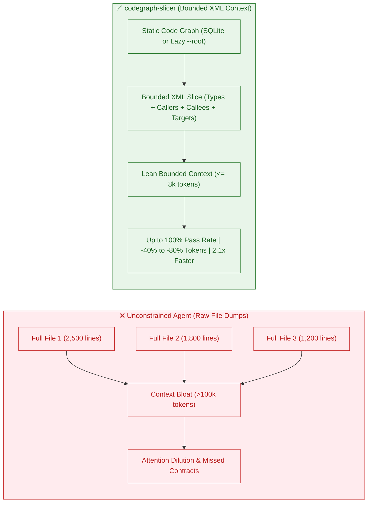

# codegraph-slicer

**Give your coding agent the relevant code before it edits.**

Ask a coding agent to change a method in a large repository and it can spend its first dozen turns finding the file, reading hundreds of lines of unrelated helpers, and chasing callers across packages. By the time it starts editing, critical DTO contracts, interface definitions, constructor state wiring, or caller assumptions may still be missing.

`codegraph-slicer` gives your agent a different starting point: the target implementation, enclosing class and interface contracts, upstream callers, and downstream dependencies in one bounded XML context slice.

Install the CLI and bundled skill, and your agent automatically checks repository structure before drowning in raw file reads. Small, straightforward tasks bypass slicing and go directly to the files; large monoliths and cross-package changes get structural context first—either from a fast local SQLite index (`sync` + `slice --db`) or immediately with zero upfront indexing via target-seeded lazy slicing (`slice --root .`).

**`v0.3.14`** · Python 3.12+ · **Python, Java, TypeScript, and JavaScript** · Apache 2.0

---

## Table of Contents

- [60-Second Quick Start](#60-second-quick-start)
- [How It Works](#how-it-works)
- [Installation & Agent Skill Setup](#installation--agent-skill-setup)
- [How Your Agent Uses the Skill](#how-your-agent-uses-the-skill)
- [The Basic CLI Workflow](#the-basic-cli-workflow)
- [Benchmark Results (`v0.3.11`)](#benchmark-results-v0311)
- [When Something Goes Wrong](#when-something-goes-wrong)
- [What's Inside](#whats-inside)
- [Philosophy](#philosophy)
- [License](#license)

---

## 60-Second Quick Start

### Step 1: Install the CLI (Python 3.12+)

```sh
uv tool install "git+https://github.com/lecholette/codegraph-slicer.git@v0.3.14"
```

### Step 2: Install the Agent Skill (Pick Your Harness)

```sh
# Claude Code:
mkdir -p "$HOME/.claude/skills/codegraph-slicer" && \
  curl -fsSL "https://raw.githubusercontent.com/lecholette/codegraph-slicer/v0.3.14/.claude/skills/codegraph-slicer/SKILL.md" \
  -o "$HOME/.claude/skills/codegraph-slicer/SKILL.md"

# Cursor (Global):
mkdir -p "$HOME/.cursor/skills/codegraph-slicer" && \
  curl -fsSL "https://raw.githubusercontent.com/lecholette/codegraph-slicer/v0.3.14/.claude/skills/codegraph-slicer/SKILL.md" \
  -o "$HOME/.cursor/skills/codegraph-slicer/SKILL.md"

# Codex (User):
mkdir -p "$HOME/.codex/skills/codegraph-slicer" && \
  curl -fsSL "https://raw.githubusercontent.com/lecholette/codegraph-slicer/v0.3.14/.claude/skills/codegraph-slicer/SKILL.md" \
  -o "$HOME/.codex/skills/codegraph-slicer/SKILL.md"
```

*(See [Installation & Agent Skill Setup](#installation--agent-skill-setup) below for Gemini CLI, Antigravity, OpenCode, and repo-scoped paths.)*

### Step 3: Index or Lazy-Slice a Local Repo

```sh
cd /path/to/your/repo

# Option A — Full or scoped workspace index (~1s for ~300 files; keeps git status clean):
GRAPH="${CODEGRAPH_DB:-$(mktemp -d)/graph.sqlite}"
codegraph-slicer sync . --db "$GRAPH"

# Check repo map + scale recommendation (tells you whether to slice or read directly):
codegraph-slicer map --db "$GRAPH" --recommend-workflow --format markdown

# Route a task prompt to exact symbols and monolith slice targets (<25 ms):
codegraph-slicer route --db "$GRAPH" \
  --prompt "Fix validation in CheckoutHandler and update callers" --format json

# Option B — Target-seeded lazy slice on huge unindexed monorepos (no upfront sync):
codegraph-slicer slice --root . --max-tokens 8000 --format xml \
  src/main/java/com/acme/checkout/CheckoutHandler.java:CheckoutHandler.processOrder

# Option C — Remote GitHub lazy slice via gh CLI (no git clone needed):
codegraph-slicer slice --repo owner/name --ref main --no-callers --max-tokens 8000 --format xml \
  src/main/java/com/acme/checkout/CheckoutHandler.java:CheckoutHandler.processOrder
```

Once the skill is installed, **you don't need to run these commands manually**—just prompt your coding agent as usual, and it will automatically sync, route, and slice when working in multi-package or monolithic repositories.

---

## How It Works



From the moment you install the CLI and skill, your agent follows a five-step structural workflow before reading large source files:

1. **Index (`sync`) or Seed Lazily (`slice --root`)**:
   - **`sync`**: Indexes Python (`.py`), Java (`.java`), TypeScript (`.ts`, `.tsx`), and JavaScript (`.js`, `.jsx`, `.mjs`, `.cjs`) source trees into a local SQLite graph in parallel (`~1s` on ~300-file repositories), pruning build/vendor directories (`node_modules`, `.git`, `build`, `target`, `.gradle`, `.next`, `dist`, `out`, `vendor`) in a single filesystem walk. Supports repeatable `--scope <dir>` for monorepo subtrees and `--skip-unparseable` for legacy files.
   - **`slice --root`**: On `10,000+`-file monorepos where you already have a target file or symbol anchor, explores only the seed file, its resolved imports/types (up to `--max-hops 2`), and grep-matched candidate callers (up to `--max-files 40`) in `~1–2s` with zero upfront database creation.
2. **Orient & Route (`map --recommend-workflow` or `route`)**:
   - Evaluates repository scale, cross-file coupling, and monoliths (`>= 300` lines, `>= 15` definitions, or `CC >= 25`).
   - Compact scopes automatically bypass slicing (`map_then_read`); monolithic or coupled scopes surface exact `slice_targets`. Minor parse failures (`<= 2%` of production files when using `--skip-unparseable`) are recorded without disabling graph recommendations.
3. **Front-Load Bounded Context (`slice --format xml`)**:
   - Extracts 3–8 target symbols in a single deduplicated, token-budgeted XML envelope (`<types_and_schemas>`, `<upstream_callers>`, `<downstream_dependencies>`, `<target_implementations>`), including class/interface contracts, Javadoc/JSDoc preambles, and field declarations.
   - Automatically condenses multi-anchor targets and depth-2 transitive types to fit the `--max-tokens` budget, and supports `--dedup-session` across follow-up turns.
4. **Read Only What Remains**:
   - Uses line-bounded reads (`offset` and `limit` from `<code_slice lines="start-end">`) only where condensed blocks or signature stubs need inspection, avoiding the double-context tax of loading both full files and slices.
5. **Verify Impact & Boundaries (`impact`, `flow`, `delta`)**:
   - Traces transitive caller blast radius (`impact`), intraprocedural Python control/data flow (`flow`), and base-vs-head import or cycle regressions (`delta`) alongside your test suite.

---

## Installation & Agent Skill Setup

### 1. Install the CLI

Requires **Python 3.12+** (`3.12`, `3.13`, or `3.14`) and **Git** (to install from GitHub). Prebuilt grammar wheels for Java, TypeScript/TSX, and JavaScript (`tree-sitter`, `tree-sitter-java`, `tree-sitter-typescript`, `tree-sitter-javascript`) are installed automatically alongside standard library modules (`sqlite3`, `ast`), so parsing works 100% offline with zero runtime downloads or cache writes.

```sh
# With uv (recommended):
uv tool install "git+https://github.com/lecholette/codegraph-slicer.git@v0.3.14"

# Or upgrade an existing uv tool installation:
uv tool install --force "git+https://github.com/lecholette/codegraph-slicer.git@v0.3.14"

# Or with pip:
python3 -m pip install "git+https://github.com/lecholette/codegraph-slicer.git@v0.3.14"
```

Verify installation:

```sh
codegraph-slicer --version   # codegraph-slicer 0.3.14
codegraph-slicer --help
```

#### Local Code & Git Behavior
- **Operates on local source trees (`sync .` or `slice --root .`)**: `codegraph-slicer` indexes local files on disk (`Python`, `Java`, `TypeScript`, `JavaScript`). No code ever leaves your machine, and the target directory **does not even need to be a Git repository** for normal workspace indexing (`sync`), `map`, `route`, `slice`, `impact`, or `flow`.
- **When Git is used at runtime**: `git` is only invoked when you explicitly pass `--revision <git-ref>` (for example, `codegraph-slicer sync . --revision origin/main --db /tmp/base.sqlite` before running `delta`), or when `slice --root` uses `git grep` as a fast path inside Git repositories (falling back automatically to `rg` or Python file scanning outside Git). In `--revision` mode, blobs are read directly from local `.git` objects (`git ls-tree` / `git cat-file`) without modifying or checking out your working tree.
- **Keeping `git status` clean**: Writing `--db` to a temp path (`$(mktemp -d)/graph.sqlite` or `/tmp/graph.sqlite`) or using `slice --root .` keeps your repository working tree 100% clean without needing `.gitignore` changes. If you prefer a repo-local database (such as `.codegraph/graph.sqlite`), run `mkdir -p .codegraph` first and add `.codegraph/` to `.gitignore` (hidden dot-directories are automatically skipped during indexing).

### 2. Add the Skill to Your Coding Harness

The bundled [`SKILL.md`](.claude/skills/codegraph-slicer/SKILL.md) teaches your coding agent **when to slice** (multi-package repos and `>= 300`-line monoliths), **when to use lazy `--root` or scoped `--scope` indexing** (huge monorepos), and **when to bypass slicing** (compact repos where direct file reads are faster). Each snippet below is self-contained:

#### Claude Code

```sh
mkdir -p "$HOME/.claude/skills/codegraph-slicer" && \
  curl -fsSL "https://raw.githubusercontent.com/lecholette/codegraph-slicer/v0.3.14/.claude/skills/codegraph-slicer/SKILL.md" \
  -o "$HOME/.claude/skills/codegraph-slicer/SKILL.md"
```

#### Cursor

```sh
# Global user skill:
mkdir -p "$HOME/.cursor/skills/codegraph-slicer" && \
  curl -fsSL "https://raw.githubusercontent.com/lecholette/codegraph-slicer/v0.3.14/.claude/skills/codegraph-slicer/SKILL.md" \
  -o "$HOME/.cursor/skills/codegraph-slicer/SKILL.md"

# Or repository-scoped skill:
mkdir -p .cursor/skills/codegraph-slicer && \
  curl -fsSL "https://raw.githubusercontent.com/lecholette/codegraph-slicer/v0.3.14/.claude/skills/codegraph-slicer/SKILL.md" \
  -o .cursor/skills/codegraph-slicer/SKILL.md
```

#### Codex

```sh
# User-scoped skill:
mkdir -p "$HOME/.codex/skills/codegraph-slicer" && \
  curl -fsSL "https://raw.githubusercontent.com/lecholette/codegraph-slicer/v0.3.14/.claude/skills/codegraph-slicer/SKILL.md" \
  -o "$HOME/.codex/skills/codegraph-slicer/SKILL.md"

# Or repository-scoped skill:
mkdir -p .agents/skills/codegraph-slicer && \
  curl -fsSL "https://raw.githubusercontent.com/lecholette/codegraph-slicer/v0.3.14/.claude/skills/codegraph-slicer/SKILL.md" \
  -o .agents/skills/codegraph-slicer/SKILL.md
```

#### Gemini CLI

```sh
mkdir -p "$HOME/.gemini/skills/codegraph-slicer" && \
  curl -fsSL "https://raw.githubusercontent.com/lecholette/codegraph-slicer/v0.3.14/.claude/skills/codegraph-slicer/SKILL.md" \
  -o "$HOME/.gemini/skills/codegraph-slicer/SKILL.md"
```

#### Antigravity

```sh
mkdir -p "$HOME/.gemini/config/skills/codegraph-slicer" && \
  curl -fsSL "https://raw.githubusercontent.com/lecholette/codegraph-slicer/v0.3.14/.claude/skills/codegraph-slicer/SKILL.md" \
  -o "$HOME/.gemini/config/skills/codegraph-slicer/SKILL.md"
```

#### OpenCode

```sh
mkdir -p "$HOME/.config/opencode/skills/codegraph-slicer" && \
  curl -fsSL "https://raw.githubusercontent.com/lecholette/codegraph-slicer/v0.3.14/.claude/skills/codegraph-slicer/SKILL.md" \
  -o "$HOME/.config/opencode/skills/codegraph-slicer/SKILL.md"
```

---

## How Your Agent Uses the Skill

Once `codegraph-slicer` is on your `PATH` and `SKILL.md` is placed in your harness's skill directory:

1. **Zero-Config Automatic Triggering**:
   - Your agent reads the `SKILL.md` description at session start and automatically invokes `codegraph-slicer` when you ask structural questions (*"who calls X"*, *"what breaks if I change Y"*) or assign multi-file engineering tasks in Python, Java, TypeScript, or JavaScript repositories.
2. **Explicit Invocation (Optional)**:
   - In **Claude Code / Cursor / Antigravity / Gemini CLI**, you can also invoke the skill explicitly via `/codegraph-slicer` or mention it in your prompt (e.g., *"Use codegraph-slicer to slice the checkout handlers before editing"*).
3. **Optional Team Repo Rule (`AGENTS.md` or `CLAUDE.md`)**:
   - If you want every agent session in a repository to maintain a persistent index in `.codegraph/graph.sqlite` (git-ignored), add these 3 lines to your project's `AGENTS.md` or `CLAUDE.md`:
     ```markdown
     ## Code Graph Indexing (`codegraph-slicer`)
     - Before reading large source files (`>= 300` lines) or grepping across packages, run `mkdir -p .codegraph && codegraph-slicer sync . --db .codegraph/graph.sqlite` and `codegraph-slicer map --db .codegraph/graph.sqlite --recommend-workflow --format markdown`.
     - When `bypass_slicer: false`, front-load one batched `codegraph-slicer slice --snapshot --db .codegraph/graph.sqlite --max-tokens 8000 --format xml <anchors...>` call for your target symbols before editing (or use `codegraph-slicer slice --root . --format xml <anchors...>` on unindexed monorepos).
     ```

---

## The Basic CLI Workflow

### 1. Sync the Repository (`sync`)

Keep the index outside the repository or in a git-ignored dot-directory (such as `.codegraph/`). Hidden dot-directories and build/dependency folders (`node_modules`, `.git`, `build`, `target`, `.gradle`, `.next`, `dist`, `out`, `vendor`) are automatically pruned during workspace indexing.

```sh
GRAPH="${CODEGRAPH_DB:-$(mktemp -d)/graph.sqlite}"
codegraph-slicer sync . --db "$GRAPH"

# Scope indexing to specific monorepo modules while preserving repo-root paths:
codegraph-slicer sync . --scope services/orders --scope libs/shared --db "$GRAPH"

# Skip legacy or broken files instead of aborting:
codegraph-slicer sync . --skip-unparseable --db "$GRAPH"

# Or index a specific Git revision:
codegraph-slicer sync . --revision HEAD --db /tmp/head.sqlite
```

`sync` is incremental and parallelized across CPU cores (`CODEGRAPH_JOBS` to override worker count): unchanged files are not reparsed when re-syncing after edits.

### 2. Orient & Route (`map --recommend-workflow` and `route`)

Check repository structure and scale before reading source files:

```sh
# Ranked PageRank repository map + scale recommendation at the top of the report:
codegraph-slicer map --db "$GRAPH" --recommend-workflow --format markdown

# Or route a specific task prompt directly to resolved anchors and monolith slice targets (<25 ms):
codegraph-slicer route --db "$GRAPH" \
  --prompt "Update CheckoutHandler.processOrder and inspect its callers" \
  --format json
```

`ScaleRecommendation` classifies the repository into one of four modes. A *monolith* is a non-test file with `>= 300` lines, `>= 15` definitions and `>= 200` lines, or `CC >= 25`:

| Mode | When It Triggers | Recommended Action |
| :--- | :--- | :--- |
| **`map_then_read`** (`bypass_slicer: true`) | Compact scope (`< 30` files & `< 5,000` LOC, or `< 50` files & `< 7,500` LOC for Python-only repositories) with no monoliths and `< 40` cross-file edges. | Read the target files directly; skip `slice` and `delta`. |
| **`slice_monoliths`** (`bypass_slicer: false`) | One or more source files are monoliths (`>= 300` lines, `>= 15` definitions with `>= 200` lines, or `CC >= 25`), even in small-file-count repositories. | Slice symbols inside the monolithic files listed in `slice_targets` instead of reading them end-to-end. |
| **`graph_optional`** (`bypass_slicer: false`) | Multi-package or strongly coupled repository (`>= 40` cross-file edges, or larger than the compact thresholds). | Front-load a batched `slice` for target symbols across packages. |
| **`direct_read`** (`bypass_slicer: true`) | Empty index or `> 2%` unparseable production files (`incomplete_index`). | Inspect source files directly. |

Skipped parse failures (when synced with `--skip-unparseable`) are reported as `skipped_files` and `skipped_languages`. They trigger `incomplete_index` only when skipped non-test files in an indexed production language exceed **2%** of production files, so one broken file in a large repository, or an unparseable script in a language the repo doesn't otherwise use, won't disable the graph. On a very small repository a single skipped file can cross 2%; fix or delete it and re-sync.

### 3. Extract One Bounded XML Context Slice (`slice --db`, `slice --root`, or `slice --repo`)

Batch 3–8 target anchors into a single call so shared types, interfaces, and callers are deduplicated. Pass `--db` (indexed snapshot), `--root` (local workspace or `--ref` Git commit), or `--repo` (remote GitHub repository via `gh` CLI; controlled by `--source-mode {auto,local,remote}`, `--cache-dir`, `--no-cache`, and `--refresh-cache`):

```sh
# From an indexed SQLite snapshot (--db):
codegraph-slicer slice --db "$GRAPH" --max-tokens 8000 --format xml \
  src/main/java/com/acme/orders/OrderPipeline.java:OrderPipeline.dispatchDueOrders \
  src/main/java/com/acme/checkout/CheckoutHandler.java:CheckoutHandler \
  src/main/java/com/acme/validation/OrderPolicyValidator.java:OrderPolicyValidator

# Or target-seeded lazy slicing on an unindexed workspace (--root, no --db needed):
codegraph-slicer slice --root . --max-tokens 8000 --format xml \
  src/main/java/com/acme/orders/OrderPipeline.java:OrderPipeline.dispatchDueOrders \
  --max-files 40 --max-hops 2        # add --no-callers to skip grep-based caller discovery

# Or remote target-seeded lazy slicing from GitHub (--repo, cached in SHA-1-verified BlobCache):
codegraph-slicer slice --repo owner/name --ref main --no-callers --max-tokens 8000 --format xml \
  src/main/java/com/acme/orders/OrderPipeline.java:OrderPipeline.dispatchDueOrders
```

The XML slice organizes structural context into four deterministic sections (plus `<coverage>` metadata in lazy `--root` / `--repo` mode):

| XML Section | Contents |
| :--- | :--- |
| **`<coverage>`** *(lazy `--root` / `--repo` mode)* | Reports `mode="lazy_target_seeded"`, `explored_files`, `indexed_files`, `max_files`, `max_hops`, `truncated`, `caller_discovery`, `tree_truncated`, `grep_note`, and any `<failed_file>` parse errors. |
| **`<types_and_schemas>`** | Enclosing class fields/constructors, interfaces, inherited types, `@property` getters, JSDoc types, and referenced DTOs (`USES_TYPE` / `INHERITS` up to 2 hops) with non-called methods folded to 1-line signatures. Multi-anchor slices automatically condense or drop depth-2 transitive types to stay within `--max-tokens`. |
| **`<upstream_callers>`** | Direct 1-hop caller snippets and dispatch windows showing how targets are invoked. |
| **`<downstream_dependencies>`** | Callee signatures, 1-line return hints, and compact same-file helper bodies (`<= 40` lines). |
| **`<target_implementations>`** | Placed at the tail of the XML envelope with top-level file imports and class header preambles preserved. Pass `--target-mode skeleton` for signature-only targets or `--dedup-session` to elide types/callers already emitted earlier in the session. |

### 4. Check Blast Radius, Data Flow, and Structural Deltas (`impact`, `flow`, `delta`)

```sh
# Transitive caller blast radius before changing a signature or return contract:
codegraph-slicer impact src/service/handler.py:RequestHandler.handle \
  --db "$GRAPH" --max-depth 3 --max-nodes 200 --format markdown

# Intraprocedural Python control and data-flow slice for a specific variable:
codegraph-slicer flow src/service/handler.py:RequestHandler.handle \
  --db "$GRAPH" --variable total --line 42 --direction backward --format markdown

# Base-vs-head structural delta, cycle detection, and import-boundary enforcement:
cp "$GRAPH" /tmp/head.sqlite
codegraph-slicer sync . --db /tmp/head.sqlite
codegraph-slicer delta --base-db "$GRAPH" --head-db /tmp/head.sqlite \
  --forbid-import com.enterprise.runtime com.enterprise.execution --max-tokens 8000
```

---

## Benchmark Results (`v0.3.11`)

Across Python, Java, TypeScript, and JavaScript benchmarks, **`codegraph-slicer` cuts agent exploration turns and tool calls by `14.4%–58.7%`, reduces input and cache-read token volume by `11.8%–80.4%`, speeds up turnaround by up to `2.1x`, and lifts multi-package task accuracy by `+12.4%` to `+69.2%`** (zero post-hoc fixups or scenario-specific rules):

### 1. Enterprise JavaScript Hard Monorepo (`289` `.js` Files, `44,219` LOC, `89` Tests + `6` Cross-Package Contracts)

Evaluated across five coding models on a 12-package enterprise CommonJS JavaScript repository containing `400–520`-line monolithic strategy/orchestration classes, barrel `index.js` re-exports, and `273` decoy modules:

| Model | Baseline (No Slicer) | With `codegraph-slicer` | Delta |
| :--- | :--- | :--- | :--- |
| **`gpt-6-luna`** | `69/89 (77.5%)`, `6/6` Contracts (`CP2: 14/18`, `CP4: 7/21`), `38` exec calls, `123,745` tokens | **`86/89 (96.6%)`**, **`6/6` Contracts (`100%`, `CP1–CP2: 100%`, `CP4: 19/21`)**, **`29` exec calls**, **`106,666` tokens** | **`+19.1%` accuracy (`+17` tests), `100%` on CP1 & CP2, `+57.1%` on CP4, `-23.7%` exec calls, `-13.8%` tokens** |
| **Cursor Auto (`auto`)** | `76/89 (85.4%)`, `4/6` Contracts (`CP2: 13/18`, `CP3: 11/18`), `18` turns, `1.24M` cache read (`205.5k` in / `21.4k` out), `1.47M` total tokens | **`87/89 (97.8%)`**, **`6/6` Contracts (`100%`, `CP2: 18/18`, `CP3: 17/18`)**, **`17` turns**, **`896k` cache read** (**`83.0k` in** / `22.8k` out), **`1.00M` total tokens** | **`+12.4%` accuracy (`+11` tests), `+33.3%` contracts (`4/6 -> 6/6`), `-59.6%` input tokens, `-27.9%` cache read tokens, `-31.8%` total tokens** |
| **`claude-haiku-5-5`** | `70/89 (78.7%)`, `2/6` Contracts (`CP2: 10/18`, `CP3: 12/18`), `53` turns, `7.03M` cache read (`86.3k` out), `399.1s`, `$0.54` | **`85/89 (95.5%)`**, **`6/6` Contracts (`100%`, `CP1–CP2: 100%`, `CP3: 17/18`)**, **`44` turns**, **`4.18M` cache read** (**`76.1k` out**), **`346.8s`**, **`$0.42`** | **`+16.8%` accuracy (`+15` tests), `+66.7%` contracts (`2/6 -> 6/6`), `-17.0%` turns, `-40.6%` cache read tokens, `-13.1%` wall time, `-21.7%` cost** |
| **Cursor Composer (`composer-2.5`)** | `87/89 (97.8%)`, `6/6` Contracts (`CP3: 16/18`), `21` turns, `1.30M` cache read (`73.4k` in / `13.3k` out), `87.6s` | **`89/89 (100.0%)`** (`v0.3.7`) / **`88/89 (98.9%, 6/6 Contracts)`** (`v0.3.8+`), **`CP1–CP4: 100%`**, `26` turns, `1.54M` cache read | **`+1.1%` to `+2.2%` accuracy (`up to 89/89 = 100.0%` across all 4 checkpoints & `6/6` contracts)** |
| **`deepseek-v4.1-flash-1017`** | `86/89 (96.6%)`, `6/6` Contracts, `97` turns, `7.68M` cache read (`114.2k` in / `96.3k` out), `828.3s` | **`86/89 (96.6%)`**, **`6/6` Contracts (`100%`, `CP1: 32/32`, `CP2: 18/18`)**, `111` turns, `8.11M` cache read (`113.7k` in / `131.4k` out), `1172.0s` | **`96.6%` accuracy (`86/89`) & `6/6` cross-package contracts (`-0.5%` input tokens)** |

### 2. Enterprise Java Hard Monorepo (`295` `.java` Files, `64,080` LOC, `89` Tests + `6` Cross-Package Contracts)

Evaluated across the same five coding models on a 12-package enterprise Java repository containing `500–640`-line monolithic handlers and `279` decoy classes:

| Model | Baseline (No Slicer) | With `codegraph-slicer` | Delta |
| :--- | :--- | :--- | :--- |
| **Cursor Composer (`composer-2.5`)** | `64/89 (71.9%)`, `6/6` Contracts, `24` turns, `1.45M` cache read (`231.8k` in / `16.8k` out), `154.9s` | **`89/89 (100.0%)`**, **`6/6` Contracts (`100%`)**, **`24` turns**, **`1.39M` cache read** (**`127.6k` in** / `15.8k` out), **`135.1s`** *(and `-62.8%` input tokens / `109.4s` `-29.4%` wall time on `v0.3.10`)* | **`+28.1%` accuracy (`+25` tests to `100.0%`), `-44.9%` to `-62.8%` input tokens, `-12.8%` to `-29.4%` wall time** |
| **`deepseek-v4.1-flash-1017`** | `30/89 (33.7%)`, `6/6` Contracts (`CP1: 4/32`), `46` turns, `2.48M` cache read (`76.7k` in / `37.2k` out) | **`75/89 (84.3%)`**, **`6/6` Contracts (`100%`, `CP1: 32/32`, `CP4: 21/21`)**, `61` turns, **`2.44M` cache read** (`88.1k` in / `42.4k` out), `346.9s` | **`+50.6%` accuracy (`+45` tests), `+87.5%` on CP1 & `100%` on CP4, `-1.6%` cache read tokens** |
| **`gpt-6-luna`** | `75/89 (84.3%)`, `6/6` Contracts (`CP2: 14/18`, `CP3: 8/18`), `20`–`63` exec calls, `84,340`–`143,489` tokens | **`86/89 (96.6%)`**, **`6/6` Contracts (`100%`, `CP1–CP2: 100%`, `CP3: 17/18`)**, **`15`–`26` exec calls**, **`80,138`–`127,302` tokens** | **`+12.3%` accuracy (`+11` tests), `-25.0%` to `-58.7%` exec calls (`63 -> 26`, `20 -> 15`), `-5.0%` to `-11.3%` tokens** |
| **`claude-haiku-5-5`** | `89/89 (100.0%)`, `6/6` Contracts, `58` turns, `6.52M` cache read (`89.0k` out), `408.1s`, `$0.64` | **`89/89 (100.0%)`**, **`6/6` Contracts (`100%`)**, **`49` turns**, **`4.81M` cache read** (**`75.0k` out**), **`337.6s`**, **`$0.42`** | **`-15.5%` turns, `-26.2%` cache read tokens, `-17.3%` wall time, `-34.4%` cost** |
| **Cursor Auto (`auto`)** | `86/89 (96.6%)`, `6/6` Contracts, `22` turns, `1.70M` cache read (`110.1k` in / `25.0k` out), `1.83M` total tokens, `403.1s` | `75/89 (84.3%)`, **`6/6` Contracts (`100%`, `CP1: 32/32`, `CP4: 21/21`)**, **`16`–`17` turns**, **`805k`–`914k` cache read** (**`81.2k` in** / **`21.1k` out**), **`940k` total tokens**, **`242.3s`** | **`-22.7%` to `-27.3%` turns (`22 -> 16`), `-26.3%` input tokens, `-46.2%` to `-52.6%` cache read tokens, `-48.7%` total tokens, `-39.9%` wall time** |

### 3. Enterprise JavaScript Monorepo (`289` `.js` Files, `44,213` LOC, `89` Tests + `6` Cross-Package Contracts)

| Model | Baseline (No Slicer) | With `codegraph-slicer` | Delta |
| :--- | :--- | :--- | :--- |
| **`deepseek-v4.1-flash-1017`** | `84/89 (94.4%)`, `5/6` Contracts, `84` turns, `4.53M` cache read (`95.6k` in / `91.1k` out) | **`86/89 (96.6%)`**, **`6/6` Contracts (`100%`)**, **`67` turns**, `5.83M` cache read (`137.9k` in / `130.5k` out) | **`+2.2%` accuracy (`#1` overall), `+16.7%` contracts (`5/6 -> 6/6`), `-20.2%` turns (`84 -> 67`)** |
| **`gpt-6.1-terra`** | `70/89 (78.7%)`, `5/6` Contracts, `20` exec calls, `67,390` tokens | **`85/89 (95.5%)`**, `5/6` Contracts, **`15` exec calls**, `74,163` tokens | **`+16.8%` accuracy (`+15` tests), `-25.0%` exec calls (`20 -> 15`)** |
| **`claude-sonnet-5-5`** | `85/89 (95.5%)`, `6/6` Contracts, `14` turns, `1,045,238` cache read, `$0.68` | **`84/89 (94.4%)`**, **`6/6` Contracts (`100%`)**, **`11` turns**, **`581,835` cache read**, **`$0.40`** | **`-21.4%` turns (`14 -> 11`), `-44.3%` cache read tokens, `-40.9%` cost** |
| **`gpt-6-luna`** | `60/89 (67.4%)`, `5/6` Contracts, `23` exec calls, `116,324` tokens | **`68/89 (76.4%)`**, **`6/6` Contracts (`100%`)**, **`19` exec calls**, **`91,080` tokens** | **`+9.0%` accuracy (`+8` tests), `+16.7%` contracts (`5/6 -> 6/6`), `-17.4%` exec calls, `-21.7%` tokens** |

### 4. Enterprise Java (`273` Files, `58k` LOC) & TypeScript (`238` Files, `36k` LOC) Monorepos (`89` Tests Each)

| Language & Benchmark | Model | Baseline (No Slicer) | With `codegraph-slicer` | Delta |
| :--- | :--- | :--- | :--- | :--- |
| **Java Monorepo**<br>(`273` `.java` files, `58k` LOC) | **`claude-sonnet-5-5`** | `89/89 (100.0%)` | **`89/89 (100.0%)`** | **`-16.3%` wall time, `-30.9%` cache creation tokens, `-18.3%` cost** |
| **Java Monorepo**<br>(`273` `.java` files, `58k` LOC) | **`gpt-6.1-terra`** | `89/89 (100.0%)`, `12` exec calls, `721k` tokens | **`89/89 (100.0%)`**, **`8` exec calls**, **`593k` tokens** | **`-33.3%` exec calls (`12 -> 8`), `-17.8%` tokens (`721k -> 593k`)** |
| **Java Monorepo**<br>(`273` `.java` files, `58k` LOC) | **`deepseek-v4.1-flash-1017`** | `89/89 (100.0%)`, `1.21M` cache read (`1.32M` total) | **`89/89 (100.0%)`**, **`878k` cache read** (**`963k` total**) | **`-23.6%` wall time, `-27.4%` cache read tokens, `-25.3%` open-weight cost** |
| **TypeScript Monorepo**<br>(`238` `.ts` files, `36k` LOC) | **`claude-sonnet-5-5`** | `89/89 (100.0%)`, `10` Bash calls | **`89/89 (100.0%)`**, **`5` Bash calls** | **`-50.0%` Bash calls (`10 -> 5`), `-11.8%` cache read tokens** |
| **TypeScript Monorepo**<br>(`238` `.ts` files, `36k` LOC) | **`gpt-6.1-terra`** | `89/89 (100.0%)`, `11` exec calls, `57.9k` tokens | **`89/89 (100.0%)`**, **`8` exec calls**, **`11.3k` tokens** | **`-27.3%` exec calls (`11 -> 8`), `-80.4%` tokens (`57.9k -> 11.3k`)** |
| **TypeScript Monorepo**<br>(`238` `.ts` files, `36k` LOC) | **`deepseek-v4.1-flash-1017`** | `89/89 (100.0%)`, `35` turns, `2.09M` cache read (`36.4k` out) | **`89/89 (100.0%)`**, **`29` turns**, **`1.48M` cache read** (**`22.5k` out**) | **`-17.1%` turns (`35 -> 29`), `-29.3%` cache read tokens, `-38.3%` output tokens** |

### 5. Python Multi-File Services (`dynamic_config_service_api`) & Pallets Click Testbed

| Benchmark & Task | Model | Baseline (No Slicer) | With `codegraph-slicer` | Delta |
| :--- | :--- | :--- | :--- | :--- |
| **`dynamic_config_service_api`**<br>(`76` tests / `26` CP3 tests) | **`claude-sonnet-5-5`** | `13/26 (50.0%)` on CP3, `23` turns, `972k` cache read | **`72/76 (94.7%)` overall, `24/26 (92.3%)` on CP3**, **`12` turns**, **`499k` cache read** | **`+42.3%` on CP3 (`13/26 -> 24/26`), `-47.8%` turns (`23 -> 12`), `-48.7%` cache read tokens, `-34.8%` cost** |
| **`dynamic_config_service_api`**<br>(`76` tests / `26` CP3 tests) | **`gpt-6.1-terra`** | `24/26 (92.3%)` on CP3, `18` exec calls, `91.6k` tokens | **`72/76 (94.7%)` overall, `26/26 (100.0%)` on CP3**, **`13` exec calls**, **`74.1k` tokens** | **`+7.7%` to `100.0%` on CP3 (`24/26 -> 26/26`), `-27.8%` exec calls (`18 -> 13`), `-19.2%` tokens** |
| **`dynamic_config_service_api`**<br>(`76` tests, Compact-Scope Segregated) | **`deepseek-v4.1-flash-1017`** | `68/76 (89.5%)`, `139` turns, `10.78M` cache read, `$10.09` | **`70/76 (92.1%)`**, **`119` turns**, **`6.34M` cache read**, **`$7.23`** | **`+2.6%` accuracy, `-14.4%` turns (`139 -> 119`), `-41.2%` cache read tokens, `-28.4%` cost** |
| **Pallets Click — Large Task**<br>(`15` files, 4-Subsystem Major Release) | **`deepseek-v4.1-flash-1017`** | `4/13 (30.8% Failure)`, `287` turns, `26.9 min`, `196k` in / `32.4M` cache, `$22.38` | **`13/13 (100.0% PASS)`** (+ `114` unit / `904` core), **`242` turns**, **`19.5 min`**, **`146k` in / `17.2M` cache**, **`$12.78`** | **`+69.2%` accuracy (`4/13 -> 13/13`), `-45` turns, `-27.5%` duration, `-47.0%` cache read tokens, `-42.9%` cost** |
| **Pallets Click — Medium Task**<br>(`5` files, `OptionGroup` & Constraints) | **Flint 39.8B** *(Local GPU)* | `17/17 (100%)`, `137` turns, `33.8 min`, `13.8M` in / `85k` out, `$0.00` | **`21/21 (100.0%)`** (+ `897` core), **`133` turns**, **`15.8 min`**, **`10.1M` in**, **`$0.00`** | **`2.1x faster` (`33.8 -> 15.8 min`), `-3.73M` input tokens (`-26.8%`), `+4` constraint tests** |
| **Pallets Click — Medium Task**<br>(`5` files, `OptionGroup` & Constraints) | **Opus 5.5 + Flint 39.8B Hybrid** | — | **`36/36 (100.0%)`**, `2` Opus + `120` Flint turns, `29.1 min`, `24.8k` Opus / `11.5M` Flint tokens, **`$0.20`** | **`100.0%` acceptance (`36/36`) at `$0.20` total cloud cost** |

---

## When Something Goes Wrong

### `StaleSnapshotError` (Exit Code `2`)
`map`, `route`, `slice`, `impact`, and `flow` open the SQLite database read-only and verify that indexed source files (and `tsconfig.json` / `tsconfig.base.json`) have not changed on disk.
- **If you want current workspace code:** Re-run `codegraph-slicer sync . --db "$GRAPH"`.
- **If you want to query the pre-edit snapshot without re-syncing:** Pass `--snapshot` (`codegraph-slicer slice --snapshot --db "$GRAPH" ...`).

### `AnchorNotFoundError` (Exit Code `2`)
When a requested symbol or file anchor cannot be resolved, `codegraph-slicer` prints `hint: did you mean:` or `hint: nearest anchor:` suggestions in copy-pasteable `path/file.ext:Class.method` format (for example, `src/main/java/com/acme/checkout/CheckoutHandler.java:CheckoutHandler.processOrder`).
- Copy the exact candidate anchor from the error diagnostic instead of guessing method names.
- If `hint: no symbol named ... in any module` appears, run `codegraph-slicer map --db "$GRAPH" --seed <module>` to list the module's symbols or pass the class anchor directly (`path/file.ext:ClassName`).

### `RequiredAnchorOverflow` & `--max-tokens` Budgets (Exit Code `2`)
`--max-tokens` bounds the complete printed JSON, Markdown, or XML output (`(len(output) + 1) // 4 + 1`, including the trailing newline). When optional callers or callees are omitted to fit the budget, exact omission counts (`<omitted>`) and line ranges (`lines="start-end"`) are reported.
- If the required target definitions themselves exceed `--max-tokens`, the CLI exits `2` with `RequiredAnchorOverflow` and prints a fixed-point verified `rerun: codegraph-slicer slice ... --max-tokens <N>` command on stderr. Copy and run that `rerun:` command directly.

### Unparseable Legacy Files (`CodeGraphParseError`, Exit Code `2`)
If a workspace contains legacy or broken files (for example, an old Python 2 script in a Java or TypeScript repo), re-run `sync` with `--skip-unparseable` (`codegraph-slicer sync . --skip-unparseable --db "$GRAPH"`). Skipped files are recorded in index metadata without blocking queries.

### Small Repositories & Double-Context Tax
On small repositories with no monoliths (`ScaleRecommendation` reports `bypass_slicer: true` / `mode: "map_then_read"`), reading 2–3 small files directly is faster and cheaper than loading both an XML slice and full files. Follow `bypass_slicer: true` and skip `slice` and `delta`.

---

## What's Inside

### CLI Commands

| Command | Purpose |
| :--- | :--- |
| **`sync`** | Index a workspace directory or Git `--revision` into SQLite (`--scope <dir>` repeatable for monorepo subtrees; `--skip-unparseable` for legacy files; incremental & parallel on re-sync). |
| **`map`** | Ranked PageRank repository map (`--seed` to focus on a package/path; `--recommend-workflow` for scale/monolith advisory; `--outline` for entity/edge schema; JSON/Markdown/XML). |
| **`route`** | Fast (`< 25 ms` warm on 1M-LOC graphs) task prompt router returning `workflow_mode`, `resolved_anchors`, `target_files`, and ranked `slice_targets`. |
| **`slice`** | Bounded XML/Markdown/JSON context slice (`--db` for indexed snapshots or `--root` for zero-setup lazy slicing with `--max-files`, `--max-hops`, `--no-callers`; `--target-mode full\|skeleton`; `--dedup-session`; `--outline`), including lightweight JPA/ORM `<data_contracts>` (table, filters, columns, relations, PII) when entity schemas appear in the slice. |
| **`impact`** | Bounded transitive caller reachability (`--max-depth`, `--max-nodes`, `--unknown-boundaries`; JSON/Markdown/XML). |
| **`flow`** | Intraprocedural Python control/data-flow slice (`--variable`, `--line`, `--direction backward\|forward`, `--data-only`, `--compact`). Python anchors only. |
| **`delta`** | Base-vs-head snapshot diff reporting modified symbols, added/removed edges, new cycles, complexity drift, and `--forbid-import` violations (`--projection legacy\|v2`). |

### Language Support Matrix

| Language | Extensions | Indexed Constructs & Static Resolution | Local `flow` |
| :--- | :--- | :--- | :--- |
| **Python** | `.py` | Classes, functions, `async def`, methods, `@property`, PEP 695 `type` aliases, C3 MRO inheritance, Protocol/ABC subtypes, constructor `self.<attr>` state coupling, context-manager (`with` / `enter_context`) type inference, and top-level file import preambles. | Yes (CFG + def-use). |
| **Java** | `.java` | Classes, interfaces, enums, records (including compact constructors), nested classes (`Outer.Inner`), constructors, methods, fields, generic type unwrapping (`List<T> -> T`), `this.field.method()` chains, overload sibling expansion, subtype call fanout, and wildcard package imports. | No (use `slice`). |
| **TypeScript** | `.ts`, `.tsx` | Classes, interfaces (included in `<types_and_schemas>`), type aliases, enums, functions, arrow callbacks, methods, `tsconfig.json` and `tsconfig.base.json` `baseUrl`/`paths` aliases, barrel `index.ts` re-exports, JSX component tags, and CSS-in-JS generic tagged template literals (`styled.div<Props>\`...\``). | No (use `slice`). |
| **JavaScript** | `.js`, `.jsx`, `.mjs`, `.cjs` | ES modules & CommonJS (`require()`, `module.exports`, `exports.x`, barrel `index.js` spreads), classes, functions, prototype assignments (`Cls.prototype.m`), constructor `this.field` inference, DI default parameter types, `new ClassName()` `USES_TYPE` edges, and JSDoc `@param`/`@returns`/`@type` annotations. | No (use `slice`). |

See [HELP.md](HELP.md) for complete command schemas and static-analysis limits.

---

## Philosophy

- **Deterministic static evidence over brute-force `grep`:** Give the agent exact type schemas, interface contracts, constructor fields, caller snippets, and file import preambles before it edits.
- **Scale-aware routing from 1k to 1M+ LOC:** Automatically bypass slicing on compact tasks while detecting and slicing monolithic files (`>= 300` lines, `>= 15` definitions, or `CC >= 25`)—and offer instant `slice --root` lazy slicing on unindexed monorepos.
- **Strict token budgets with explicit omission accounting:** Every command respects `--max-tokens` (including trailing-newline accounting across JSON, Markdown, and XML) and reports exact counts of omitted records so nothing is silently dropped.
- **Read-only queries & freshness guarantees:** Only `sync` writes to SQLite. All query commands open the database read-only and verify source freshness unless `--snapshot` is explicitly requested.
- **Static evidence complements runtime tests:** Call graphs and slices accelerate localization and prevent contract mismatches; test suites verify runtime behavior.

```sh
uv run --with pytest pytest -q
```

## License

Copyright 2026 Chris Cholette. Licensed under the Apache License, Version 2.0; see [LICENSE](LICENSE) and [NOTICE](NOTICE).
